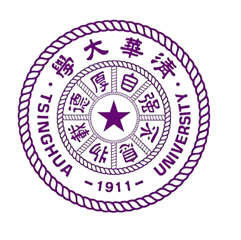
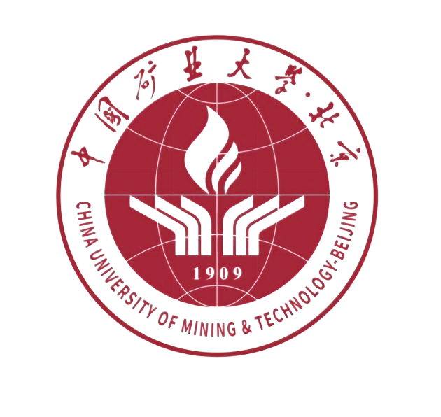

<section class="cv-section" markdown="1">
## Contact

- [Email](mailto:jyyd23@mails.tsinghua.edu.cn)
</section>

<section class="cv-section" markdown="1">
## Education

  <article class="education-entry">
    <h3 class="school-heading">Tsinghua University</h3>
    
<strong>Ph.D. in Safety Science and Engineering</strong>, School of Safety Science, Beijing, China

    
09/2020 – 06/2026 · Supervisor: Assistant Professor Xiaole Zhang

    
<strong>Dissertation:</strong> Research on the Transport Evolution and Quantitative Risk of Hazardous Substances

    
Direct-entry Ph.D.; transferred from the M.Sc. track — master’s degree not conferred.

  </article>
  <article class="education-entry">
    <h3 class="school-heading">China University of Mining and Technology (Beijing)</h3>
    
<strong>B.Sc. in Safety Engineering</strong>, School of Emergency Management and Safety Engineering, Beijing, China

    
09/2016 – 06/2020 · Supervisor: Professor Wei Zhao

    
<strong>Dissertation:</strong> Influence of open and closed windows on the vertical spread characteristics of fire

  </article>

</section>

<section class="cv-section" markdown="1">
## Research Experience

My research includes: **AI4Safety** (the application of machine learning & deep learning to physical-world public-safety problems such as emergency management and disaster response — *not* cybersecurity), **atmospheric pollutant diffusion prediction**, **data assimilation for hazardous-chemical leakage forecasting**, and **probabilistic risk analysis**. 

* **Atmospheric transport and quantitative risk of ultra-fine particles** *(09/2023 - present)*
  - **ML Model:** Developed a stacked ensemble machine learning framework (Stem-PNC) integrating data-driven and physicochemical models to simulate ultrafine particle (UFP) number concentrations at high spatiotemporal resolution (1 km; 1 hour).
  - **Risk Analysis:** Enabled regional-scale UFP exposure assessment and health risk evaluation, providing new insights into environmental pollutant impacts.
  - Articles have been published in [**Nature Communications**](https://www.nature.com/articles/s41467-025-56581-8).

* **Data Assimilation-Driven Environmental Impact Assessment Technology for Hazardous Chemical Leakage** *(09/2023 - present)*
  - **Rapid Prediction Model:** Developed a deep learning-based model for real-time forecasting of emergency scenarios using meteorological data.
  - **Data Assimilation with Deep Learning:** Use a deep learning surrogate model to update and correct predictions through sensor data assimilation.
  - **Low-Cost Sensor Network & Web Platform:** Established a low-cost sensor network and a web-based system for real-time data collection, prediction, and model calibration.
  - Achieved applied outcomes with two registered *software copyrights*.
  - Research from this project was published in [**Building and Environment**](https://doi.org/10.1016/j.buildenv.2026.114797).

* **Food Security Supervision Model Design** *(09/2021-2023/09)*
  - Built a big-data-driven supervisory system for grain storage safety, combining statistical analysis, predictive modeling, and clustering methods.
  - Use Neo4j graph database for relationship mining, and apply natural language processing (NLP) for sentiment analysis and text summarisation.
  - Articles have been published in [*Journal of Safety Science and Resilience*](https://www.sciencedirect.com/science/article/pii/S2666449622000500?via%3Dihub).
</section>

<section class="cv-section" markdown="1">
## Publications



</section>

<section class="cv-section" markdown="1">
## Patents and software copyrights

Core contributor to three intellectual property applications: two registered software copyrights and one invention patent application.

1. **Yudie Jianyao**, Xiaole Zhang, Shuai Liu. **Rapid Pollutant Dispersion Generation and Visualization Software**. Software copyright registration No. **2025SR0129602**, 2025. *Registered.*
2. **Yudie Jianyao**, Xiaole Zhang, Yuheng Cheng. **Real-Time Data Transmission and Visualization Software**. Software copyright registration No. **2025SR0130418**, 2025. *Registered.*
3. Xiaole Zhang, **Yudie Jianyao**, Yuheng Cheng, Qi Zhang. **High-Precision Particle Number Concentration Estimation Method Based on Stacking Ensemble Learning**. Chinese invention patent publication No. **CN 120354992 A**. *Under substantive examination.*

</section>
<section class="cv-section" markdown="1">
## Skills

* Models: 
  * Micro-scale dispersion model system GRAMM–GRAL
* Computer skills:
  * Python (Pandas, scikit-learn, Numpy, Geopandas, PyTorch, TensorFlow, Django)
  * MATLAB
  * C++
  * SQL
  * Neo4j
  * ArcGIS
  * 3ds Max
  * Arduino
</section>

<section class="cv-section" markdown="1">
## Presentations

<a href="/publications/">Conference papers and poster presentations</a>

</section>

<section class="cv-section" markdown="1">
## Service and leadership

* *2024.09-2025.09*	**Vice President, Graduate Student Union**, School of Safety Science and Engineering, Tsinghua University
  * Led student-union academic initiatives and coordinated cross-departmental events; organized a school-level public lecture attracting 300+ attendees and managed all logistics, publicity, and follow-up materials. (Event planning, stakeholder coordination)
* *2024.09-2025.09*	**Head, Academic Department**, Department of Engineering Physics, Tsinghua University
  * Organized and chaired regular research discussion groups (~10–15 participants each) to foster peer feedback and collaborative projects; coordinated invited talks and reading sessions. (Community building, seminar curation)
* *2024.09-2025.09*	**Class President**, Ph.D. Class 2024 (Year-One Cohort), School of Safety Science and Engineering, Tsinghua University (Awarded “Advanced Graduate Collective of Tsinghua University, 2024”)
* *2023.09-2024.09*	**Class President**, Ph.D. Class 231, Department of Engineering Physics, Tsinghua University
</section>

<section class="cv-section" markdown="1">
## Prizes, awards, fellowships

* **Deng Jiaxian Scholarship**, Tsinghua University, **2025**.
* **First-Class Comprehensive Scholarship**, Tsinghua University, **2025**.
  - Participated in the 2025 Tsinghua University Student Awards Ceremony.
* **Second Prize for Graduate Student Social Service**, Tsinghua University, **2025**.
* Departmental Comprehensive Scholarship, School of Safety Science and Engineering, Tsinghua University, 2024.
* National Scholarship Representative (Top 1%)
Special Prize Scholarship, China University of Mining and Technology (Beijing), 2020.
* Outstanding Graduate (Top 2%), China University of Mining and Technology (Beijing), 2020.
* Excellent Thesis Award, China University of Mining and Technology (Beijing), 2020.
* First Prize (Beijing Division), China Undergraduate Mathematical Contest in Modeling (MCM), 2018.
* Meritorious Winner, Mathematical Contest in Modeling (MCM, USA) (Top 8%), 2018.
</section>

